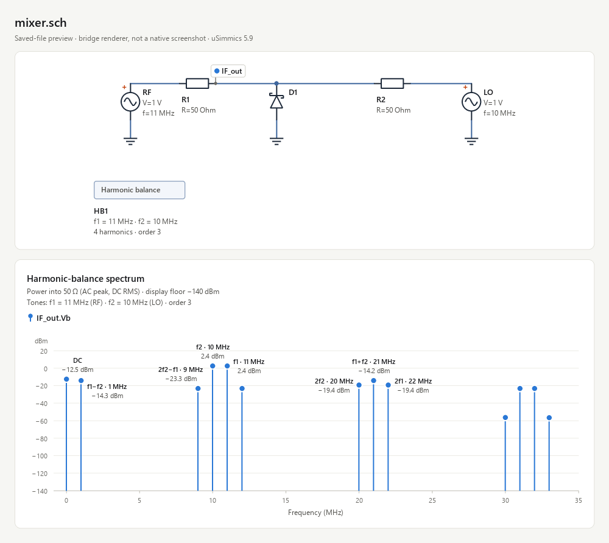

# uSimmics MCP Bridge

A local MCP server for a tested subset of **uSimmics 5.9**. Build, save, inspect and preview circuits, run harmonic-balance simulations, and compare parameter variants without driving the desktop UI.

**Alpha 0.3.0a1.** Native simulation is tested on Windows. Pure-Python format, workspace, protocol and preview tests also run on Linux. This is an independent integration, not an official uSimmics/QucsStudio product. Original Qucs and Qucs-S use different formats.

[中文说明](docs/README.zh-CN.md) · [Tools and examples](docs/tools.md) · [Contributing](CONTRIBUTING.md)



## Install

Requirements: Python 3.11+, [uv](https://docs.astral.sh/uv/), and a separately installed [uSimmics 5.9](https://qucsstudio.de/download/). The bridge does not bundle or download the simulator, its model libraries, or course handouts.

```powershell
uv tool install git+https://github.com/timecino-hub/usimmics-mcp-bridge.git
usimmics-bridge configure --installation-root "C:/Apps/uSimmics" --project-root "C:/CircuitProjects"
usimmics-bridge doctor
```

Alternatively install a wheel from the GitHub release using `uv tool install <wheel-path>`. For development use `uv sync --extra dev --locked`.

The default config is `%LOCALAPPDATA%/usimmics-bridge/config.json` on Windows, and `$XDG_CONFIG_HOME/usimmics-bridge/config.json` (or `~/.config/...`) elsewhere. Override it with `USIMMICS_BRIDGE_CONFIG` or the CLI's `--config`. `configure` can discover common install locations or `USIMMICS_HOME`; overwriting config requires `--force` and makes a backup. `doctor` returns JSON and a nonzero exit status until the native 5.9 environment is ready.

## Connect an MCP client

The installed command is `usimmics-mcp` (stdio, no network listener). For Codex in PowerShell:

```powershell
codex mcp add usimmics -- (Get-Command usimmics-mcp).Source
```

For other clients, use the absolute path printed by `Get-Command usimmics-mcp` as `command`; arguments are empty. Optionally set `USIMMICS_BRIDGE_CONFIG` in the server environment. Reload that client's MCP server to discover the tools. No API key or cloud service is required.

Before a chat reloads its tool catalog you can still exercise the actual MCP transport:

```powershell
usimmics-mcp-call list
usimmics-mcp-call environment_status
usimmics-mcp-call preview_schematic --arguments-file request.json
```

The client reports JSON metadata and local image paths without dumping base64. `preview_schematic` itself returns native MCP image content.

## Available tools

| Task | Tools |
|---|---|
| Environment and projects | `environment_status`, `list_projects`, `create_project` |
| Read, save and copy | `read_schematic`, `save_schematic`, `clone_schematic` |
| Build and edit | `build_schematic`, `inspect_schematic`, `update_parameters` |
| Validate and inspect layout | `validate_schematic`, `preview_schematic` |
| Simulate and save results | `run_schematic`, `read_results`, `publish_results` |
| Explore variants | `parameter_sweep`, `compare_results` |

A normal workflow is: build/read → save → validate → run → preview → optionally publish the verified dataset. Example designs live in `examples/`; see [the complete walkthrough](docs/tools.md).

## Scope and correctness

- Supported native file version: `QucsStudio Schematic 5.9`; component subset R, C, L, Vac, Vdc, Diode, Filter, GND, and one HB block. BAT54 is loaded from the user's installation when requested. Vdc is accepted as an HB circuit component; DC operating-point analysis is not provided.
- Builder routes are explicit and orthogonal. Different-net crossings/touches are rejected. Existing supported schematics distinguish a bare crossing from an endpoint/T junction. Mirroring and other unsupported encodings fail explicitly.
- Saves validate supported sections, property records, Rect/Legend/trace diagrams and connectivity. Native markers and other diagram types are not yet supported. Unknown native features are not silently generalized.
- Results reader supports the tested real/complex QucsData v2 subset. Unknown record types fail. Nested sweeps, transient analysis, AC/SP commands and arbitrary device models are not supported.
- Preview is a **bridge-rendered view of saved coordinates**, not a native screenshot. Components and wires stay where they are saved; a text label that would collide is nudged clear and listed in `adjusted_labels`, and net labels are drawn as tags with a leader to their node. It omits Paintings annotations with a warning. The spectrum has one panel per node voltage on a shared frequency axis, using 50-ohm voltage power (AC peak, DC RMS) with a labelled −140 dBm display floor. The strongest lines carry their mixing product (`f1−f2`), frequency and level, also returned as `spectrum_markers`. Raw data is unchanged, and a dataset that does not match the schematic is flagged inside the image.
- Save/update operations require the inspected SHA256 for existing files and preserve backups. Cooperative cross-process locks serialize bridge writers; external GUI editors do not participate. Unsaved GUI buffers are not accessible. Reload a GUI document before saving over bridge edits.
- Runs and sweeps use independent output directories. Publishing requires matching source/result provenance and `DataSet=*.dat`. Sweeps preserve the source, allow at most 20 points and limit each solver call to 30 seconds. Comparisons use actual samples, never implicit interpolation.
- Configured roots reduce accidental file access; this local tool is not an operating-system sandbox. It runs the simulator executable from the user-configured installation. See [security boundaries](SECURITY.md).

## Tests and release

```powershell
uv run pytest -m "not integration" --basetemp .testtmp-unit -q
uv run pytest -m integration --basetemp .testtmp-native -q
uv build
```

Native tests discover a local uSimmics installation (or `USIMMICS_HOME`) and otherwise skip. They generate their own circuits in temporary directories: voltage divider, RC/RL analytic responses, BAT54 mixer and an isolated parameter sweep. No personal lab files are required. CI checks portable tests on Windows/Linux with Python 3.11/3.12 and builds the wheel/source distribution. Dependency resolution is recorded in `uv.lock`.

## License

Bridge code and original examples are MIT-licensed. uSimmics and external models retain their own terms and are not included. The community project [qucs-mcp](https://github.com/leonardoAB1/qucs-mcp) was reviewed during research; this bridge's implementation is independent and does not vendor that repository.
