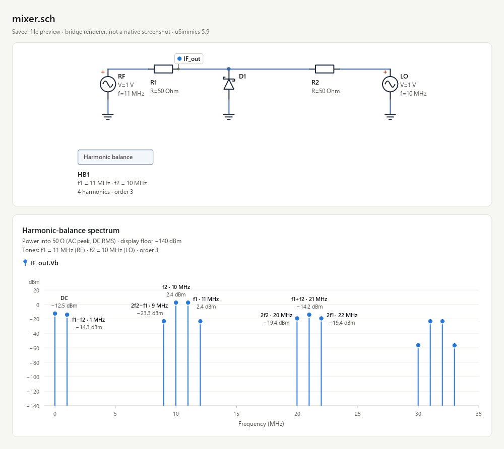

# uSimmics MCP Bridge

[](https://github.com/timecino-hub/usimmics-mcp-bridge/actions/workflows/ci.yml)


Let an AI assistant build, simulate and inspect **uSimmics 5.9** circuits for you. The bridge is a local [MCP](https://modelcontextprotocol.io) server: your assistant edits saved `.sch` files, runs the native harmonic-balance solver in the background and gets back a picture of the circuit and its spectrum, without clicking through the desktop UI.

> **Alpha 0.3.0a2.** Native simulation targets Windows with separately installed uSimmics 5.9. Portable CI checks package installation, files, previews and MCP; it does not establish that the native solver passes. This is an independent project, not an official uSimmics/QucsStudio product. Original Qucs and Qucs-S use different file formats.

[中文说明](docs/README.zh-CN.md) · [Tools and examples](docs/tools.md) · [Contributing](CONTRIBUTING.md) · [Security](SECURITY.md)



## What you can ask for

- "Create a project, build a 1 MHz voltage divider, simulate it and show me the spectrum."
- "Run the BAT54 mixer example and tell me the IF power at 1 MHz."
- "Sweep R1 over 50, 100 and 200 Ohm and compare the IF level at 1 MHz."
- "Clone the mixer, move the LO to 12 MHz and compare the IF power of both versions."

The assistant answers these with the bridge's tools, listed [below](#tools).

## Quick start

You need Python 3.11+ and [uv](https://docs.astral.sh/uv/). Native simulation also requires a separately installed [uSimmics 5.9](https://qucsstudio.de/download/) on Windows. The bridge does not bundle or download the simulator, its model libraries or course material. Template discovery works before configuration; the divider can be built and previewed with a [portable workspace configuration](docs/tools.md#portable-workspace-without-a-simulator).

1. Install the commands:

   ```powershell
   uv tool install git+https://github.com/timecino-hub/usimmics-mcp-bridge.git
   ```

2. Tell the bridge where uSimmics and your projects live, then check the setup:

   ```powershell
   usimmics-bridge configure --installation-root "C:/Apps/uSimmics" --project-root "C:/CircuitProjects"
   usimmics-bridge doctor
   ```

   `doctor` prints separate `workspace_ready`, `solver_ready` and `bat54_ready` fields. Its overall `ready` requires a usable workspace and solver. The BAT54 model is an optional capability: its absence does not block the divider or other RLC circuits.

3. Add the server to your MCP client (next section) and reload the client's tools.

To pin a version, install the wheel from a [GitHub release](https://github.com/timecino-hub/usimmics-mcp-bridge/releases) with `uv tool install <wheel-path>`.

## First example from an installed package

Both examples ship inside the wheel. You can discover them from any working directory, without a source checkout or a configured simulator:

```powershell
usimmics-bridge examples list
usimmics-bridge examples show voltage_divider
```

After configuring a workspace, these PowerShell commands create a project, export a complete build request and draw the divider. No native solver is executed:

```powershell
@{ name = "first_example" } | ConvertTo-Json | Set-Content -Encoding utf8 create.json
$project = usimmics-bridge call create_project --arguments-file create.json | ConvertFrom-Json
$schematic = Join-Path $project.project_path "divider.sch"
usimmics-bridge examples export voltage_divider --output build.json --schematic-path $schematic
usimmics-bridge call build_schematic --arguments-file build.json
@{ path = $schematic } | ConvertTo-Json | Set-Content -Encoding utf8 preview.json
usimmics-bridge call preview_schematic --arguments-file preview.json
```

The last command returns an `image_path` for the PNG. Choose a new project name and export filename when repeating the example: existing projects and export files are preserved. With a ready native solver, `usimmics-bridge run $schematic` then returns an isolated dataset; pass its `dataset` path to `preview_schematic` to add the spectrum. Building the `mixer` template also requires the installed BAT54 model.

An MCP client can use `list_schematic_templates` and `get_schematic_template` for the same examples. The latter returns a `specification` object; add the intended `.sch` `path` and pass it to `build_schematic`.

## Connect an MCP client

The server command is `usimmics-mcp`. It talks MCP over stdio, opens no network port and needs no API key or cloud service. GUI clients may not see your shell's `PATH`, so register the absolute path that `(Get-Command usimmics-mcp).Source` prints.

**Claude Code** (`--scope user` makes it available in every project):

```powershell
claude mcp add --transport stdio --scope user usimmics -- (Get-Command usimmics-mcp).Source
```

**Codex:**

```powershell
codex mcp add usimmics -- (Get-Command usimmics-mcp).Source
```

**Claude Desktop and other clients configured with JSON:**

```json
{
  "mcpServers": {
    "usimmics": { "command": "C:\\Users\\you\\.local\\bin\\usimmics-mcp.exe" }
  }
}
```

The server takes no arguments. To use a config file other than the default, set `USIMMICS_BRIDGE_CONFIG` in the server's environment.

Before your client reloads, you can exercise the real MCP transport from a terminal. It prints JSON and the paths of rendered images instead of dumping base64:

```powershell
usimmics-mcp-call list
usimmics-mcp-call environment_status
usimmics-mcp-call preview_schematic --arguments-file request.json
```

## Tools

| Task | Tools |
|---|---|
| Environment and projects | `environment_status`, `list_projects`, `create_project` |
| Installed examples | `list_schematic_templates`, `get_schematic_template` |
| Read, save and copy | `read_schematic`, `save_schematic`, `clone_schematic` |
| Build and edit | `build_schematic`, `inspect_schematic`, `update_parameters` |
| Check and look | `validate_schematic`, `preview_schematic` |
| Simulate and keep results | `run_schematic`, `read_results`, `publish_results` |
| Explore variants | `parameter_sweep`, `compare_results` |
| Long-running jobs | `start_job`, `job_status`, `cancel_job` |

The usual flow is get a template → create a project → build and save → validate → preview → run, then optionally publish the verified dataset so the uSimmics GUI can plot it. Installed templates have one source under `usimmics_bridge/data/examples`; [docs/tools.md](docs/tools.md) walks through the full workflow.

## What the preview shows

`preview_schematic` returns a PNG that the bridge draws from the saved file, plus JSON metadata. It is not a screenshot of the uSimmics window.

- **Schematic.** Components and wires sit at their saved coordinates. Junction dots mark real T-junctions; bare crossings stay unconnected. Net labels appear as tags with a leader to their node. A label that would collide is moved to the nearest free spot and named in `adjusted_labels`. Paintings annotations are omitted with a warning.
- **Spectrum.** One panel per node voltage on a shared frequency axis, in dBm into 50 Ω (AC peak, DC RMS) with a −140 dBm display floor. The strongest lines are labelled with their mixing product (`f1−f2`, `2f2−f1`, …), frequency and level. `spectrum_markers` returns those markers numerically, with dBm rounded to two decimals; the image labels use one decimal. Raw data is never changed.
- **Provenance.** A dataset that does not match the saved schematic is flagged in the image and in `warnings`.

## Supported scope

- **File format:** `QucsStudio Schematic 5.9` only.
- **Components:** R, C, L, Vac, Vdc, Diode, Filter, GND and one harmonic-balance (HB) block. BAT54 is loaded from your installation on request. Vdc works as a component inside HB; DC operating-point analysis is not provided.
- **Results:** the tested real/complex QucsData v2 subset. Unknown record types fail.
- **Not yet supported:** transient, AC and S-parameter analyses, nested sweeps, arbitrary device models, mirrored components, native diagram markers and other diagram types. Unsupported input fails explicitly instead of being guessed.

## Safety and data integrity

- **Validated saves.** Saves check sections, property records, Rect/Legend/trace diagrams and connectivity before writing. Builder routes are explicit and orthogonal, and crossings or touches between different nets are rejected.
- **No silent overwrites.** Writing to an existing file needs its inspected SHA256, keeps a backup and replaces the file atomically. Cooperative cross-process locks serialize bridge writers. The uSimmics GUI does not take part in those locks and its unsaved buffers are invisible to the bridge, so reload a document in the GUI before saving over bridge edits.
- **Isolated runs.** Every run and sweep gets its own output folder. Publishing requires matching source/result provenance and `DataSet=*.dat`. Sweeps leave the source unchanged, allow at most 20 points and limit each solver call to 30 seconds. Comparisons use actual samples, never interpolation.
- **Recoverable work.** Sweep summaries are checkpointed after each point, including failures and cancellation, and can be resumed with `resume_from`. A persistent MCP client can start a background job, inspect progress and cancel the active solver. One-shot `usimmics-mcp-call` processes cannot retain background jobs; use ordinary run/sweep calls there.
- **Result provenance.** Successful runs record a run ID, source snapshot, duration and dataset validation in a manifest. Published datasets retain a neighboring `.dat.manifest.json` so their origin can still be checked after copying them into the project. See [results and provenance](docs/results.md) for validation and warning states.
- **Local only.** Configured roots guard against accidental file access but are not an operating-system sandbox. The bridge runs `simulator.exe` from the installation you configure. See [SECURITY.md](SECURITY.md).

## Configuration

The config file is `%LOCALAPPDATA%/usimmics-bridge/config.json` on Windows and `$XDG_CONFIG_HOME/usimmics-bridge/config.json` (or `~/.config/...`) elsewhere. Point to another file with `USIMMICS_BRIDGE_CONFIG` or the CLI's `--config`. `configure` can discover common install locations or `USIMMICS_HOME`. Overwriting an existing config needs `--force` and keeps a backup.

## Development

```powershell
uv sync --extra dev --locked
uv run --locked pytest -m "not integration" --basetemp .testtmp-unit -q
uv build
uv export --locked --no-dev --no-emit-project --no-hashes --output-file .ci-runtime-requirements.txt
python scripts/smoke_wheel.py --wheel dist --requirements .ci-runtime-requirements.txt
```

CI tests the locked dependencies on Windows/Linux with Python 3.11/3.12 and separately resolves the latest dependency versions permitted by the package. Each job builds distributions, installs the wheel in a fresh virtual environment, and runs the portable create → build → preview → read/save flow through real MCP stdio outside the checkout. The smoke check confirms the imported code comes from that environment and verifies the returned PNG.

Native tests remain opt-in: `uv run --locked pytest -m integration --basetemp .testtmp-native -q -rs`. They find uSimmics through local discovery or `USIMMICS_HOME` and skip when absent. A skipped native test is not evidence of solver compatibility. They generate their own divider, RC/RL, BAT54 and parameter-sweep circuits. See [CONTRIBUTING.md](CONTRIBUTING.md) for release verification.

## License

Bridge code and original examples are MIT-licensed. uSimmics and external models keep their own terms and are not included. The community project [qucs-mcp](https://github.com/leonardoAB1/qucs-mcp) was reviewed during research; this bridge is an independent implementation and does not vendor that repository.
